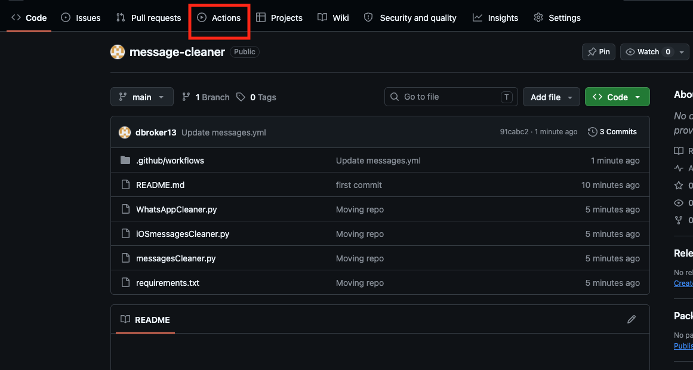
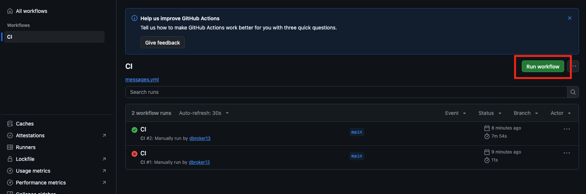

# Message Cleaner
This repo is created to clean messages from applicaitons on Mobile Devices 

## CI Run

Select Actions


Run the workflow


## Local Run

set API Token Variable
export Messages_API_Token=token
Execute the script with python 
ex 
``` python WhatsAppCleaner.py ```


## Notes on devices

## 

- Implement better logging
- Implement ADB DND on/off
- Clear specific message channel message by message
- Implement parallel threads ie all the devices with WhatsApp etc
- Test all channels deleted
- Loop until all converstations are deleted
